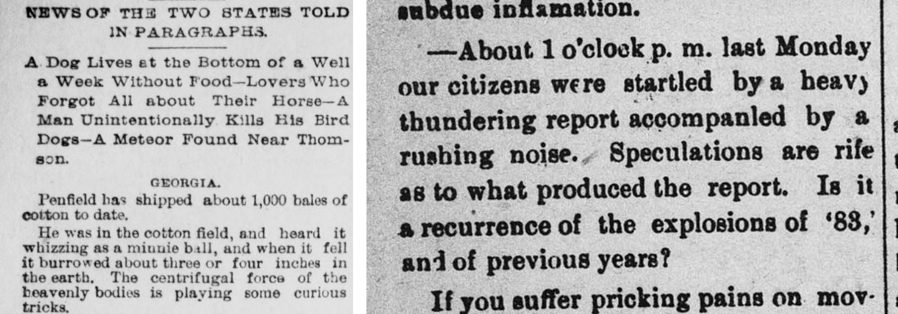
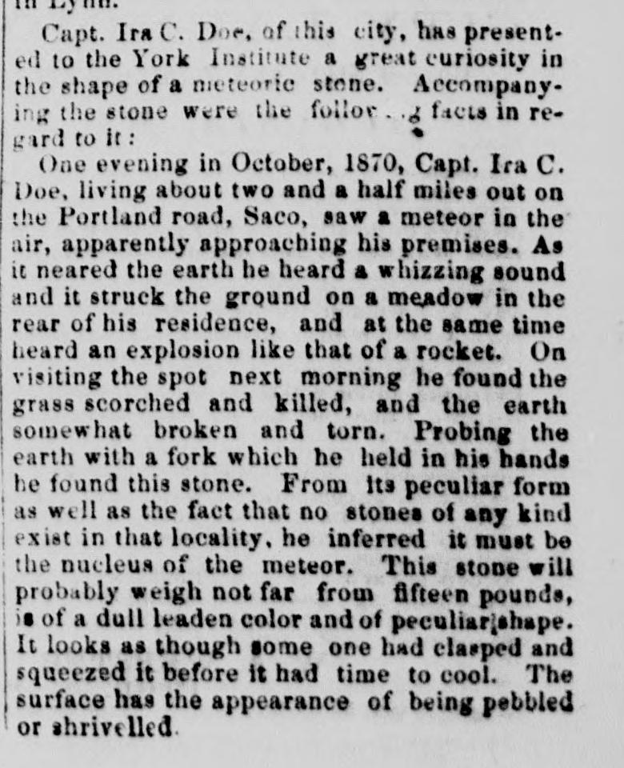
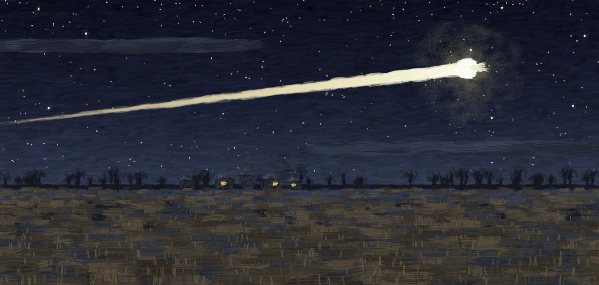
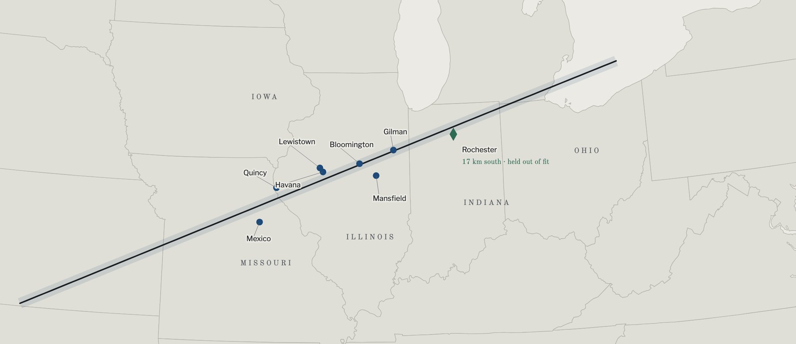

# Sky In Print

In November 2026 the [Meteoritical Bulletin](https://www.lpi.usra.edu/meteor/metbull.cfm?code=23973) changed the Thomson, Georgia (1888) meteorite from a find to an observed fall, after I sent them the 1888 newspaper reports of it coming down, so a stone that was already in the catalogue finally has the right story attached, and that's the first thing this project has actually changed in the record.

 
Left, the <a href="https://www.loc.gov/resource/sn86063034/1888-11-07/ed-1/?sp=6">Savannah Morning News</a> on Wilson hearing it come in. Right, the <a href="https://gahistoricnewspapers.galileo.usg.edu/lccn/sn90052031/1888-10-19/ed-1/seq-3/">Lincolnton News</a> that Friday, from a town 36 km north, where "our citizens were startled" by a heavy report at 1 p.m. that same Monday.

Sky In Print is me reading about two hundred years of American newspapers for fireballs and meteorite falls and then chasing every claimed stone forward to see what became of it. It's all written up at **[skyinprint.com](https://www.skyinprint.com)**, which has the thirteen cases told through the original scans, a map of every fireball that got printed in more than one town, and a reconstruction of the great fireball of 21 December 1876.

## How I did it

### Finding the reports

The text comes from [American Stories](https://huggingface.co/datasets/dell-research-harvard/AmericanStories), a research group's OCR of the Library of Congress newspaper scans. I run keyword patterns over it to pull out anything that might be about the sky, and then a local model (Flint, running on my own machine) sorts the actual sky reports out of a pile that's mostly horse races, ads and fiction. All the model does is shrink the pile, whether anything really came from space gets worked out later by reading. Before the full run I did a pilot on windows picked ahead of time, and I committed the rules and prompts to `prereg/` before reading any of the evaluation data, so there was no way to quietly tune it until the numbers looked good.

The full sweep runs from 1770 to 1964 with plenty of gaps, and on the fall side it triaged 245,249 candidate articles down to 6,250 fall reports, while the fireball side ended up with 24,391 reports grouped into 11,307 events, 807 of which got printed in two or more cities.

### Reading them

Papers reprinted each other constantly, so a dozen clippings can all be one guy's story, and the town a paper came out of usually isn't where the witness was standing either. I group reports into reprint families with OCR-tolerant copy detection and then read the families myself and grade them.

### Chasing the stones

Whenever a report says somebody picked up a stone, I follow it through later papers, science journals and museum accession records, and send a lot of emails to small-town historical societies and librarians. Most of those trails die somewhere, the Seaford, Delaware stone turned out to be chalcedony, Middleburg, Florida was limonite, the Smithsonian has no record of three stones that were supposedly sent there, and plenty of others just drop out of the papers. A few are still open, like Capt. Ira Doe's stone from Saco, Maine, which he gave to the York Institute (now the Saco Museum). The running record is in `results/falls/`.

 
The <a href="https://www.loc.gov/resource/sn82014248/1873-11-20/ed-1/?sp=3">Daily Kennebec Journal</a>, 20 November 1873. "It looks as though some one had clasped and squeezed it before it had time to cool."

### Checking what it misses

To see how much slips through I checked it against the 114 recorded US falls in the years I swept. Of those, 48 show up with a real report somewhere in the keyword candidates and the model caught 47 of them, and the other 66 never reached the model at all, because their papers aren't in the corpus, the OCR mangled them or the keyword search missed them (I've only rescanned a handful to see which). I also did a blind check of the model's calls and agreed with it on 22 of 24. Details are in `results/validation/` and `results/eyecheck/`.

### The 1876 fireball

This is the biggest event in the data, with 25 independent sources, so I fit a ground track from the seven towns that saw it pass overhead, and the path comes out 17 km from the Rochester, Indiana meteorite site, which wasn't used in the fit. That's the reconstruction on the [fireball page](https://www.skyinprint.com/fireball).

 
Blue dots are the seven towns that reported it overhead, the line is the best-fit great circle through them, and the green diamond is Rochester, held out as the check.

## What's in here

- `site/` is the website and the downloadable data ([data dictionary](site/data/README.md))
- `src/skyinprint/` is the pipeline: filtering, triage, reprint grouping, fireball tracks and the follow-up tools
- `prereg/` has the pre-registration, keyword patterns, triage prompts and pinned corpus manifests
- `results/` has the pilot report, the recall checks, the fall trails and the outreach log
- `reference/` has the meteorite catalogue snapshot and a few other reference lists

It's a curated snapshot, so the raw newspaper downloads, private emails and working review queues aren't in here, and the triage step talks to my own model server, so if you wanna rerun it you're gonna be doing a fair bit of rewiring.

## Caveats

The map shows what got printed and survived, and that mostly follows how many papers were digitized for a given year and state. Each fireball pin sits at a publishing town, which usually isn't where anyone saw it, and some of the groupings probably still lump unrelated reports together. None of the open stone leads is a confirmed meteorite yet.

## Credits and license

Newspaper text is from [American Stories](https://huggingface.co/datasets/dell-research-harvard/AmericanStories) (Dell et al., 2023), built on the Library of Congress [Chronicling America](https://chroniclingamerica.loc.gov) scans, and the known meteorites come from NASA's Meteorite Landings dataset and the Meteoritical Bulletin. Code is MIT ([LICENSE](LICENSE)), derived data is CC BY 4.0, and third-party data keeps whatever terms it came with.
